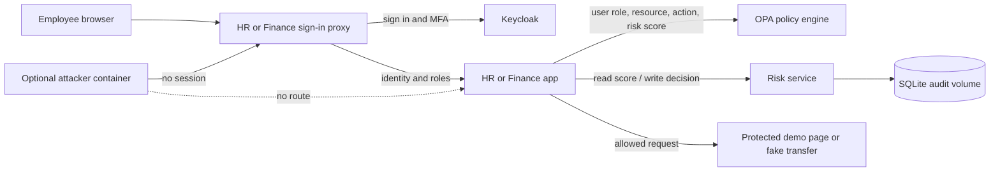

# Architecture

Each protected app and its proxy share a department network. The proxies also share the identity network with Keycloak. OPA and the risk service attach to the HR and Finance networks so both apps can request policy decisions and risk scores. The apps themselves do not share a network.

For each app request, the app asks OPA whether the user role, requested action, resource, and current risk score satisfy policy. The app records the decision in the risk service's SQLite database before it returns the page or performs a fake transfer. A failed audit write blocks the protected action.

The attacker container is an outsider test. It can reach the sign-in proxies without having a session, but it is not connected to the internal HR or Finance networks.
