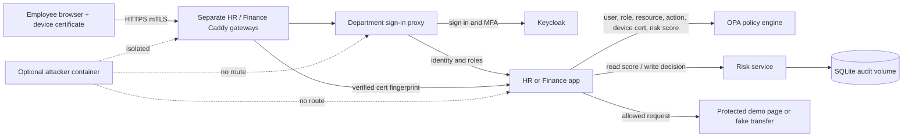

# Architecture

Each protected app, its proxy, and its TLS gateway share only that department network. The proxies also share the identity network with Keycloak. The separate gateways publish only loopback ports to the host. OPA and the risk service attach to the HR and Finance networks so both apps can request policy decisions and risk scores. The apps themselves do not share a network.

The browser must present a client certificate at the HTTPS gateway. The gateway verifies the certificate against the lab CA and forwards its fingerprint on to the app. For each app request, the app asks OPA whether the certificate, user role, requested action, resource, and current risk score satisfy policy. The app records the decision in the risk service's SQLite database before it returns the page or performs a fake transfer. A failed audit write blocks the protected action.

The attacker container is isolated on its own network. It cannot reach the gateways, sign-in proxies, or protected apps.
